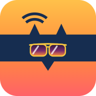
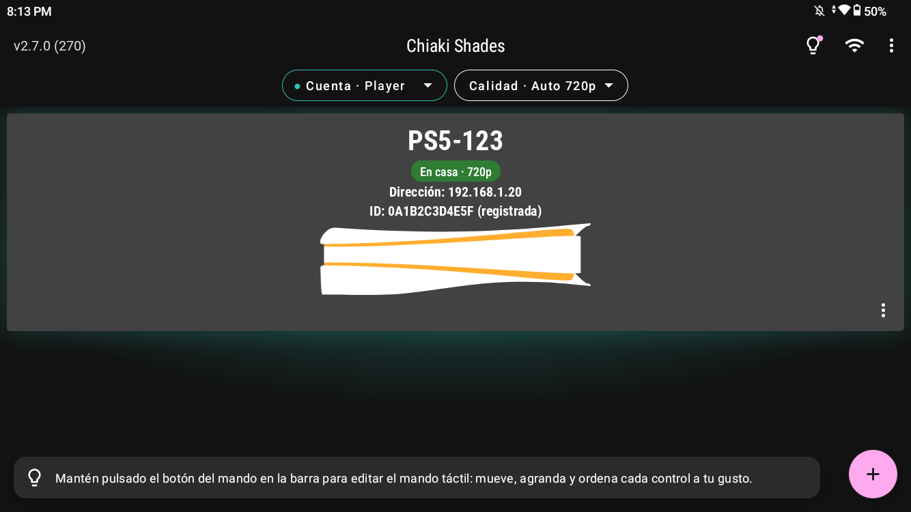
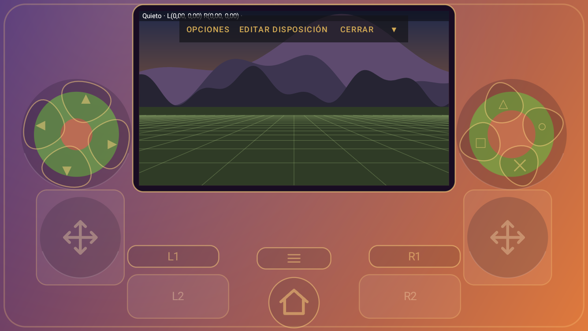
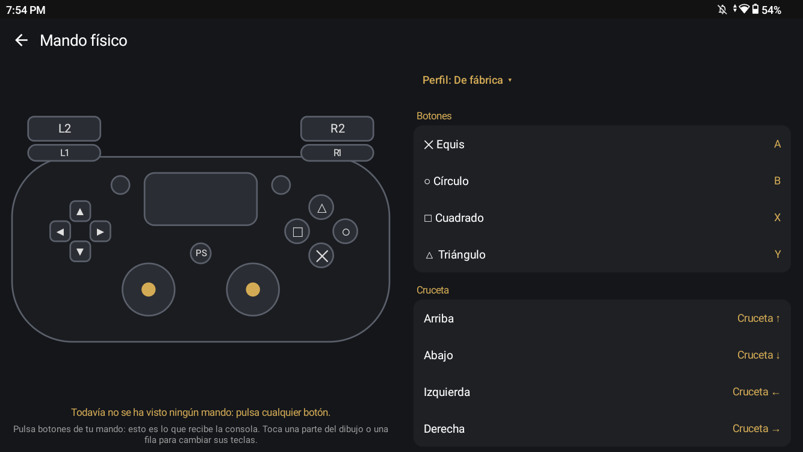
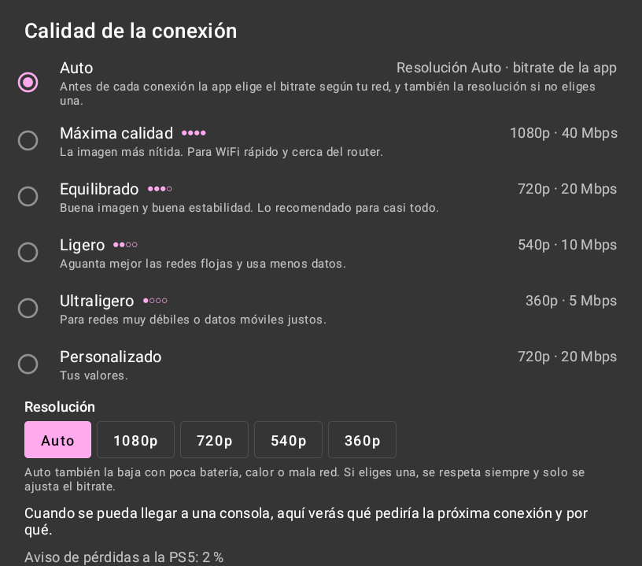

<div align="center">



# Chiaki Shades

**Cliente de PS Remote Play para Android, pensado para consolas portátiles y teléfonos, con una imagen que se adapta a tu pantalla.**

[English](README.md) · Español


</div>

Juega a tu PS4 o PS5 desde un teléfono o una consola portátil Android, en casa (o fuera, con tu propia VPN), con el
vídeo adaptado a tu pantalla y el aspecto que más te guste. Chiaki Shades es software libre, una versión modificada de
[chiaki-ng](https://github.com/streetpea/chiaki-ng) para Android. Tiene nombre, icono e identificador propios, así que
se instala junto a cualquier otro Chiaki.

<p align="center">
  
  
</p>
<p align="center">
  
  
</p>

## Qué aporta

**Una imagen que encaja en cualquier pantalla**
- **Stretch óptico**: llena las pantallas que no son 16:9 (3:2, 16:10, 4:3, 20:9…) sin barras negras. Una lente
  suave estira los bordes y deja el centro intacto.
- Modos Normal, Zoom, Estirar y Óptico, que se cambian en vivo durante la partida.
- Escalado **HQ** (Catmull-Rom con anti-ringing y nitidez adaptativa) y un **debanding** ligero para cielos y niebla.
- **Looks de color**: presets (Cine, Vívido, Natural+, Cálido, Noche, Película antigua, Blanco y negro…) que recuerdan
  tus retoques y se previsualizan en vivo con una pulsación larga en el botón Color. Los looks se pueden exportar
  como shader de mpv.

**Calidad que se adapta**
- Perfiles de calidad desde Máxima (1080p) hasta Ultraligero (360p), y **Auto**, que antes de cada conexión elige el
  bitrate según tu red, y la resolución según tu pantalla, la batería y la temperatura.
- Las pérdidas se le cuentan a la consola hasta un tope, para que proteja el vídeo sin hundir el bitrate.

**Fácil de poner en marcha**
- **Registra la consola dentro de la app**: inicias sesión con Sony en tu propio navegador, escribes el PIN y listo.
  Sin scripts.
- **Varias cuentas de PlayStation**, cada una con su color, y una misma consola registrada con cada una.
- Despierta una consola en reposo y entra cuando de verdad está lista. Al salir, puedes dejarla en reposo.

**Controles**
- Un **mando táctil** medido en milímetros, con zonas que no sueltan el pulgar, gatillos que además mueven su stick,
  L3/R3 con doble toque o apretando más fuerte, y un editor de disposición con disposiciones guardadas.
- **Modo Consola**: el vídeo se encoge arriba, dentro de una carcasa dibujada (Atardecer, Grafito o Hielo), con los
  controles alrededor. Todo se puede probar en un juego de práctica sin conectarte.
- **Giroscopio**: los controles de movimiento de la consola, o el giroscopio como stick, activado con los botones que
  elijas. **Recentrar movimiento** (un botón del pad, una tecla del mando físico o el panel de la partida) lo devuelve
  al frente.
- **Mandos físicos**: qué hace cada botón, con perfiles, gatillos analógicos en las portátiles y un probador en vivo.
- **Vibración** bien hecha, también en juegos de PS5 (la app se presenta como un DualSense y convierte sus hápticos en
  vibración), con un panel de sonido y vibración durante la partida.

**Comodidades**
- Cada consola dice dónde está: en casa, fuera por VPN (ver [Jugar fuera de casa](#jugar-fuera-de-casa)) o sin
  respuesta, con una explicación. Una consola encontrada en casa y añadida por dirección sale en una sola tarjeta.
- Reconexión rápida (opcional): al salir, la sesión queda en pausa un rato y volver es instantáneo.
- Ventana pequeña (picture-in-picture), modo juego y No molestar durante la partida.
- Exportar e importar los ajustes con casillas. Las claves de las consolas no van salvo que las marques, con aviso.

## Requisitos

- Android 7.0 o superior con OpenGL ES 3.0.
- Una PS4 o PS5 con Remote Play activado y una cuenta de PlayStation.
- Para jugar fuera de casa: tu propia VPN hacia la red de tu casa (ver [Jugar fuera de casa](#jugar-fuera-de-casa)).

## Instalar

Descarga `chiaki-shades-<versión>.apk` desde **[Releases](../../releases)** y ábrelo. Android te pedirá permiso para
instalar apps desde ese origen. Las versiones nuevas se instalan encima y conservan tus ajustes.

Después toca **+ → Registrar consola**: inicia sesión con tu cuenta de PlayStation en el navegador, vuelve a la app,
elige tu consola y escribe el PIN que muestra (PS5: Ajustes → Sistema → Uso a distancia → Vincular dispositivo; PS4:
Ajustes → Ajustes de conexión de Uso a distancia → Añadir dispositivo).

## Jugar fuera de casa

Chiaki Shades se conecta **directamente** a tu consola, sin pasar por los servidores de Sony. En casa funciona tal
cual. Fuera de casa necesitas un camino hasta la red de tu casa: **tu propia VPN**.

La consola no puede instalar una VPN, así que hace falta otro aparato encendido en casa que haga de puerta: una
Raspberry Pi, un PC, un servidor o un router con WireGuard. Con Tailscale, por ejemplo, ese aparato se llama "subnet
router": encontrarás cómo montarlo en [su documentación](https://tailscale.com/kb/1019/subnets).

Cuando la VPN está encendida, la app lo nota: pregunta directamente a cada consola que añadiste por dirección,
comprueba que es la tuya, y la tarjeta dice **Fuera de casa · por VPN**. Si no responde, al tocarla te explica por qué
(¿VPN apagada? ¿consola apagada del todo?).

## Privacidad

- Sin anuncios, sin analítica, sin telemetría. La app habla con tu consola, y con Sony solo mientras registras.
- El inicio de sesión de Sony se abre en **tu propio navegador**: la app nunca ve tu contraseña ni tu sesión de Sony.
  Solo recibe un código de un solo uso, lo convierte en tu Account ID y tira el código.
- El Account ID y las claves de las consolas se quedan en tu aparato. Solo salen en un archivo de exportación que tú
  decidas hacer.

## Compilar

```bash
git clone --recursive https://github.com/gmtrnv/chiaki-shades.git
```

Hace falta JDK 17, el SDK de Android con el NDK 26.1.10909125 y CMake 3.22.1, `protoc` y Python con el paquete
`protobuf`. No hace falta Android Studio.

- **Windows (Git Bash)**: `bash scripts/android-debug-build.sh` compila una APK de depuración; con `install` además
  la instala por adb. El script espera protoc instalado con winget y un entorno de Python en `.venv`
  (`uv venv && uv pip install protobuf`).
- **Otros sistemas**: con `protoc` y el `protobuf` de Python en el PATH, ejecuta `./gradlew assembleDebug` en
  `android/`.

`scripts/android-release-build.sh` compila la APK optimizada y firmada. Lee tu propia llave de
`android/local.properties` (`chiakiKeystore`, `chiakiKeystorePW`, `chiakiKeyAlias`, `chiakiKeyPW`). Una APK firmada
con otra llave no se instala encima de las versiones oficiales: desinstala antes, o usa la de depuración.

Los shaders se pueden comprobar sin aparato con `bash scripts/check-shader.sh`.

### Dónde está cada cosa

| Ruta | Qué hay |
|---|---|
| `lib/` | La biblioteca del protocolo de Remote Play, de Chiaki y chiaki-ng (C). |
| `android/app/src/main/cpp/` | El puente con la biblioteca y la decodificación de audio y vídeo. |
| `android/app/src/main/assets/shaders/` | El shader de la imagen: lente, HQ, debanding, color, viñeta y grano. |
| `…/java/com/metallic/chiaki/stream/` | Pantalla de la partida, renderer, cuentas de la lente y el color, vibración. |
| `…/common/` | Ajustes, perfiles de calidad, presets de color, mapeo del mando, cuentas. |
| `…/regist/` | Registro e inicio de sesión de Sony. |
| `…/discovery/` | Búsqueda de consolas, en casa y por VPN. |
| `…/touchcontrols/console/` | Mando táctil, carcasas, editor de disposición y juego de práctica. |

## Opiniones y fallos

Los fallos y las ideas son bienvenidos en [Issues](../../issues), en español o en inglés. Para problemas de conexión
ayuda mucho un registro de sesión: Ajustes → General → Registros de sesión.

## Licencia y créditos

GNU AGPL-3.0 con una excepción para enlazar con OpenSSL (ver [COPYING](COPYING)), igual que los proyectos de los que
viene: puedes usarla, estudiarla, modificarla y compartirla, siempre que quien reciba la app pueda conseguir también su
código fuente con la misma licencia. Se ofrece sin ninguna garantía.

Chiaki Shades es una versión modificada de [chiaki-ng](https://github.com/streetpea/chiaki-ng) (Street Pea y
colaboradores), que viene de [Chiaki](https://git.sr.ht/~thestr4ng3r/chiaki) (Florian Märkl), a través de
[chiaki-ng-android-extended](https://github.com/SalamiTheMan/chiaki-ng-android-extended) (SalamiTheMan). Gracias a
todos ellos. También incluye oboe, curl, nanopb, Jerasure y gf-complete, cada uno con su propia licencia.

> Este proyecto no tiene relación con Sony Interactive Entertainment ni está respaldado por ella. PlayStation, PS4,
> PS5 y DualSense son marcas de Sony Interactive Entertainment.
