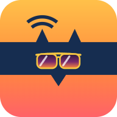
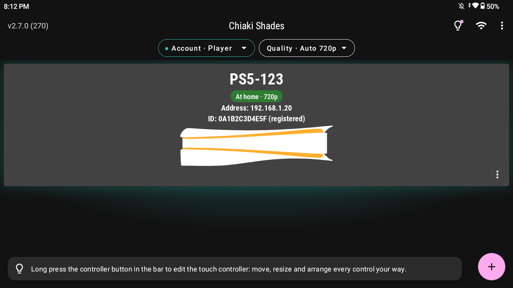
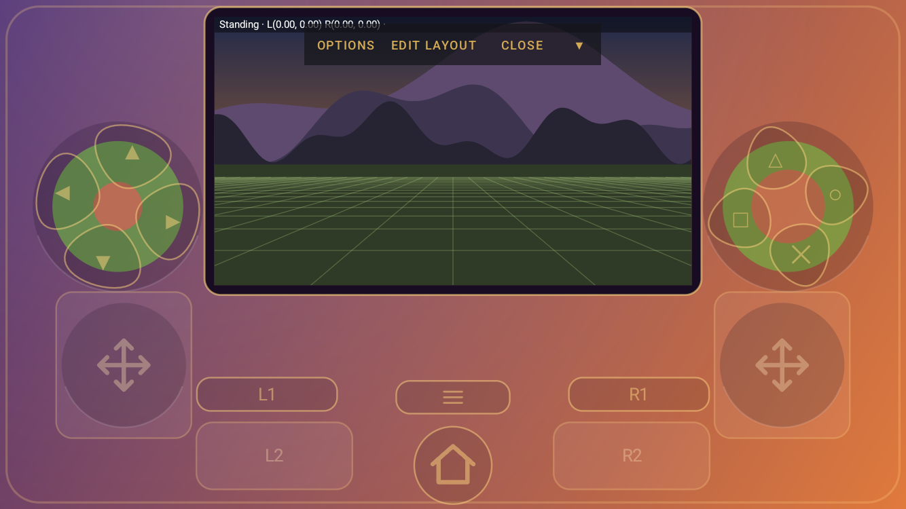
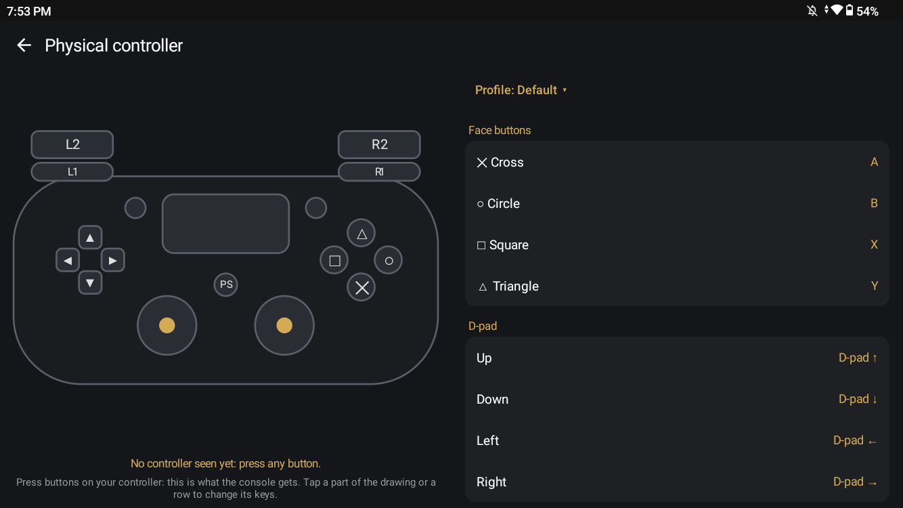
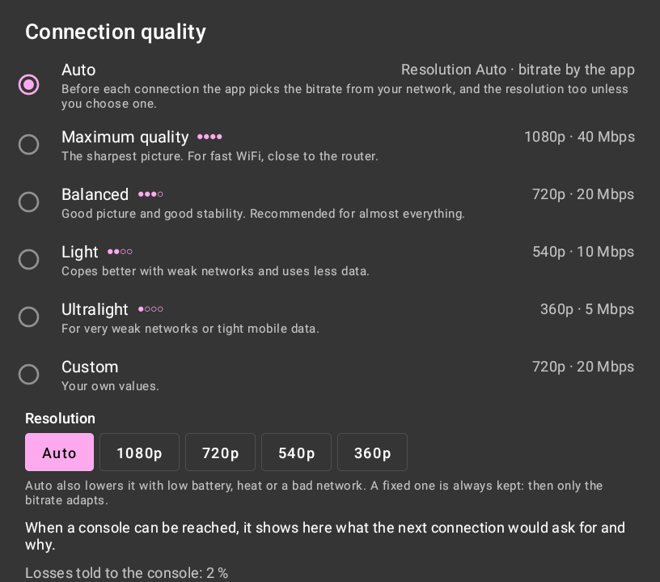

<div align="center">



# Chiaki Shades

**A PS Remote Play client for Android, made for handhelds and phones, with a picture that fits your screen.**

English · [Español](README.es.md)


</div>

Play your PS4 or PS5 on an Android phone or handheld, at home (or away, with your own VPN), with the video adapted to
your screen and the look you like. Chiaki Shades is free software, a modified version of [chiaki-ng](https://github.com/streetpea/chiaki-ng)
for Android. It has its own name, icon and package, so it installs next to any other Chiaki.

<p align="center">
  
  
</p>
<p align="center">
  
  
</p>

## What it adds

**A picture that fits any screen**
- **Optical stretch**: fills screens that are not 16:9 (3:2, 16:10, 4:3, 20:9…) with no black bars. A soft lens
  stretches the edges and leaves the centre untouched.
- Display modes Normal, Zoom, Stretch and Optical, switched live during the game.
- **HQ** scaling (Catmull-Rom with anti-ringing and adaptive sharpening) and a light **debanding** for skies and fog.
- **Color looks**: presets (Cinematic, Vivid, Natural+, Warm, Night, Vintage film, Black and white…), each one remembering
  your tweaks, previewed live with a long press on the Color button. Looks can be exported as an mpv shader.

**Quality that adapts**
- Quality profiles from Maximum (1080p) to Ultralight (360p), plus **Auto**, which picks the bitrate from your network
  before each connection, and the resolution from your screen, battery and temperature.
- Losses are reported to the console up to a cap, so it protects the video without sinking the bitrate.

**Easy setup**
- **Register a console inside the app**: sign in with Sony in your own browser, type the PIN, done. No scripts.
- **Several PlayStation accounts**, each with its own color, and one console registered with each of them.
- Wake a console in rest mode and connect when it is really ready. Leave it in rest mode when you quit.

**Controls**
- A **touch controller** measured in millimetres, with zones that keep your thumb, triggers that also move their
  stick, L3/R3 by double tap or by pressing harder, and a layout editor with saved layouts.
- **Console mode**: the video shrinks to the top inside a drawn shell (Sunset, Graphite or Ice), with the controls
  around it. Try everything in a practice game without connecting.
- **Gyroscope**: the console's motion controls, or the gyroscope as a stick, turned on by buttons you choose.
- **Physical controllers**: per-button mapping with profiles, analog triggers on handhelds, and a live tester.
- **Vibration** done properly, also in PS5 games (the app presents itself as a DualSense and turns its haptics into
  rumble), with a sound and vibration panel during the game.

**Comfort**
- Each console shows where it is: at home, away through a VPN (see [Playing away from home](#playing-away-from-home))
  or not reachable, with an explanation. A console found at home and added by address shows as one card.
- Quick reconnect (optional): quitting pauses the session for a while, and coming back is instant.
- Small window (picture-in-picture), game mode and Do not disturb while playing.
- Settings export and import with checkboxes. Console keys stay out unless you tick them, with a warning.

## Requirements

- Android 7.0 or later with OpenGL ES 3.0.
- A PS4 or PS5 with Remote Play turned on, and a PlayStation account.
- To play away from home: your own VPN to your home network (see [Playing away from home](#playing-away-from-home)).

## Install

Download `chiaki-shades-<version>.apk` from **[Releases](../../releases)** and open it. Android will ask you to allow
installing apps from that source. New versions install over the old one and keep your settings.

Then tap **+ → Register Console**: sign in with your PlayStation account in the browser, come back to the app, pick
your console and type the PIN it shows (PS5: Settings → System → Remote Play → Link Device; PS4: Settings → Remote
Play Connection Settings → Add Device).

## Playing away from home

Chiaki Shades connects **directly** to your console, without going through Sony's servers. At home it just works.
Away from home you need a way into your home network: **your own VPN**.

The console cannot run a VPN itself, so another device that stays on at home has to act as the door: a Raspberry Pi,
a PC, a server or a router with WireGuard. With Tailscale, for example, that device is called a "subnet router": you
will find how to set one up in [its documentation](https://tailscale.com/kb/1019/subnets).

When the VPN is on, the app notices: it asks each console you added by address directly, checks it is yours, and the
card says **Away from home · via VPN**. If it does not answer, tapping it explains why (VPN off? console fully off?).

## Privacy

- No ads, no analytics, no telemetry. The app talks to your console, and to Sony only while you register.
- Sony's sign-in opens in **your own browser**: the app never sees your password or your Sony session. It only
  receives a one-time code, turns it into your Account ID and throws the code away.
- The Account ID and the console keys stay on your device. They leave it only in an export file you choose to make.

## Build

```bash
git clone --recursive https://github.com/gmtrnv/chiaki-shades.git
```

You need JDK 17, the Android SDK with NDK 26.1.10909125 and CMake 3.22.1, `protoc`, and Python with the `protobuf`
package. Android Studio is not needed.

- **Windows (Git Bash)**: `bash scripts/android-debug-build.sh` builds a debug APK; add `install` to install it with
  adb. The script expects protoc from winget and a Python venv in `.venv` (`uv venv && uv pip install protobuf`).
- **Other systems**: with `protoc` and Python's `protobuf` on the PATH, run `./gradlew assembleDebug` in `android/`.

`scripts/android-release-build.sh` builds the optimized, signed APK. It reads your own key from
`android/local.properties` (`chiakiKeystore`, `chiakiKeystorePW`, `chiakiKeyAlias`, `chiakiKeyPW`). An APK signed with
another key will not install over the official releases: uninstall first, or use the debug build.

Shaders can be checked without a device with `bash scripts/check-shader.sh`.

### Where things are

| Path | What |
|---|---|
| `lib/` | The Remote Play protocol library from Chiaki and chiaki-ng (C). |
| `android/app/src/main/cpp/` | The bridge to the library, audio and video decoding. |
| `android/app/src/main/assets/shaders/` | The picture shader: lens, HQ, debanding, color, vignette and grain. |
| `…/java/com/metallic/chiaki/stream/` | Streaming screen, renderer, lens and color maths, vibration. |
| `…/common/` | Settings, quality profiles, color presets, controller mapping, accounts. |
| `…/regist/` | Registration and Sony sign-in. |
| `…/discovery/` | Finding consoles, at home and through a VPN. |
| `…/touchcontrols/console/` | Touch controller, shells, layout editor and practice game. |

## Feedback

Bug reports and ideas are welcome in [Issues](../../issues). For connection problems, a session log helps a lot:
Settings → General → Session Logs.

## License and credits

GNU AGPL-3.0 with an exception for linking with OpenSSL (see [COPYING](COPYING)), like the projects it comes from:
you can use, study, change and share it, as long as whoever gets the app can also get its source code under the same
license. It comes with no warranty.

Chiaki Shades is a modified version of [chiaki-ng](https://github.com/streetpea/chiaki-ng) (Street Pea and
contributors), which comes from [Chiaki](https://git.sr.ht/~thestr4ng3r/chiaki) (Florian Märkl), by way of
[chiaki-ng-android-extended](https://github.com/SalamiTheMan/chiaki-ng-android-extended) (SalamiTheMan). Thanks to all
of them. It also includes oboe, curl, nanopb, Jerasure and gf-complete, each under its own license.

> This project is not affiliated with or endorsed by Sony Interactive Entertainment. PlayStation, PS4, PS5 and
> DualSense are trademarks of Sony Interactive Entertainment.
